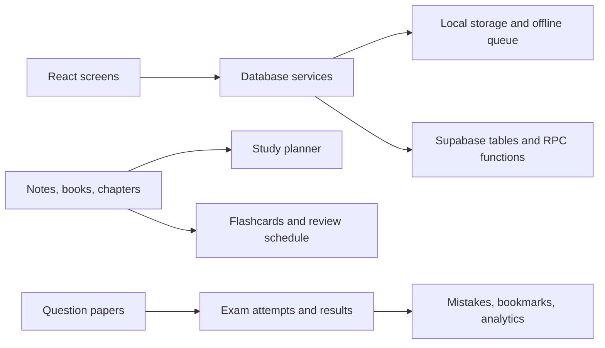

# Study Hub documentation

This folder is the maintained guide to the app's modules and how they fit together. For local setup and the original product overview, start with the [project README](../README.md).

## Guides

- [Exams and practice](modules/exams-and-practice.md) — paper creation/import, visibility, exam sessions, attempts, results, and practice modes.
- [Study content](modules/study-content.md) — notes, subject books, chapters, imports, HTML lessons, whiteboards, study plans, and flashcards.
- [Review and progress](modules/review-and-progress.md) — mistakes, spaced repetition, bookmarks, and analytics.
- [Accounts, offline use, and deployment](modules/accounts-offline-deployment.md) — authentication, local persistence, cloud sync, and PWA behavior.
- [Database setup](database/README.md) — fresh-project setup and safe guidance for existing deployments.
- [Supabase SQL catalog](../supabase/migrations/README.md) — module-by-module index of the runnable schema and migrations.

## Application map

| Area | Route | Main implementation |
| --- | --- | --- |
| Dashboard | `/` | `src/components/Dashboard.tsx` |
| Exam library | `/library` | `src/components/Dashboard.tsx` |
| Practice | `/practice` | `src/components/Dashboard.tsx` |
| Notes and books | `/notes` | `src/components/StudyNotes.tsx`, `src/components/StudyBooks.tsx` |
| Study planner | `/planner` | `src/components/StudyPlanner.tsx` |
| Flashcards | `/flashcards` | `src/components/Flashcards.tsx`, `src/services/flashcards.ts` |
| Mistakes and review | `/mistakes`, `/review` | `src/components/ReviewDashboard.tsx`, `src/components/ReviewSession.tsx` |
| Bookmarks | `/bookmarks` | `src/components/Dashboard.tsx` |
| Analytics | `/analytics` | `src/components/Dashboard.tsx` |
| Paper authoring | `/studio` | `src/components/AdminTestStudio.tsx` |
| Exam session | `/exam/:paperId` | `src/components/ExamInterface.tsx` |

Most feature screens are dashboard tabs rendered by `src/App.tsx`. Shared data types are in `src/types/index.ts`; persistence and offline fallbacks are in `src/services/database.ts`.

## Data flow



## Development checks

```bash
npm run typecheck
npm run build
```
